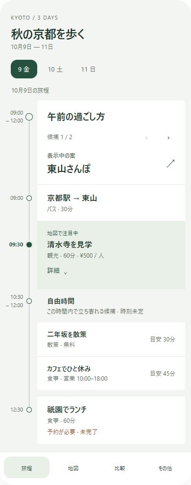
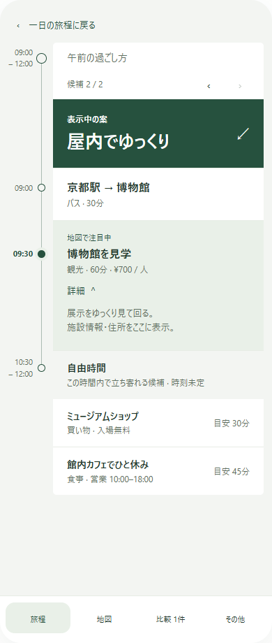

# Phase 5 承認モック

2026-10-16。チャットで合意した「見出しでまとめる」案の最終状態を、このリポジトリだけで参照できるよう保存した。正式な挙動と受入条件は [SPECIFICATION.md §24](../../../SPECIFICATION.md)、実装項目は [PHASE5_PLAN.md](../../PHASE5_PLAN.md) を正本とする。

## 参照ファイル

- [通常の旅程画面](approved-mobile.png)：カード左外側の共通タイムライン、案名・本文の横スワイプ、下部メニューバー。
- [候補の全画面表示](approved-expanded.png)：表示中の案を広く表示し、元の旅程へ戻る。撮影時は詳細展開・選択1件が残っている。
- [操作できる参照モック](approved-mock.html)：HTMLフラグメントの保存コピー。ブラウザで開いて候補の左右切替、案名の全画面表示、戻る、詳細、比較、その他メニューを確認できる。

元のモックはこのチャットの`itinerary-swipe.html`。セクション角丸5pxの調整と、カードを縦断して左側に揃う時刻・丸いノード・線を反映した版である。別チャットや別worktreeでは、このディレクトリを参照し、元のチャット専用パスに依存しない。

## 合意した見た目と操作

1. 構造は見出しと本文で表し、親子カードを枠・インデントで重ねない。
2. 「東山を歩く / 屋内で過ごす」のトグルを置かず、「表示中の案・東山さんぽ」の見出しと本文が一緒に横へ動く。
3. 案名をタップすると候補・系列を全画面表示し、戻っても直前の候補と閲覧状態を保つ。
4. カードの左外側に共通タイムライン列を設け、時刻・丸いノード・接続線を揃える。自由時間内の時刻未定候補に架空の時間を割り当てない。
5. 下部に旅程・地図・比較・その他。通常画面は旅程を中心にし、更新・保存・フィルター等は補助メニューへまとめる。
6. 深緑、明るいニュートラルの背景、薄い区切りと面の差、セクション角丸5pxを基準にする。

## モックと製品実装の違い

- 旅程名・日時・費用・候補数は架空のサンプル。製品ではNotion由来の任意のデータを表示する。
- 画像は390px幅の配置資料。全体の高さはチャットのプレビューに合わせたもので、実端末の画面高やSafe Areaを規定しない。
- 地図は領域だけ、補助メニューの内容は説明だけ。製品では既存Leaflet、現在地、保存、同期、絞り込み等の本当の処理へ接続する。
- モックの丸いノードは装飾。製品では既存の意味・44px操作域・キーボードからのフォーカス操作を維持する。
- モックは線を簡略化している。製品は同一場所の時間進行と移動、地点と活動の既存の区別を保つ。
- モックの`window.openai`はチャット内状態、Tweakはデザイン調整、Lucideはホスト供給である。通常ブラウザでは一部アイコンや調整UIが省略されても、候補切替等の配置は確認できる。これらへの依存を製品コードに持ち込まない。
- UI状態の永続化、ダークテーマ、固定高さ、サンプル件数は製品要件にしない。Phase 4の公開payload限定保存を維持する。

